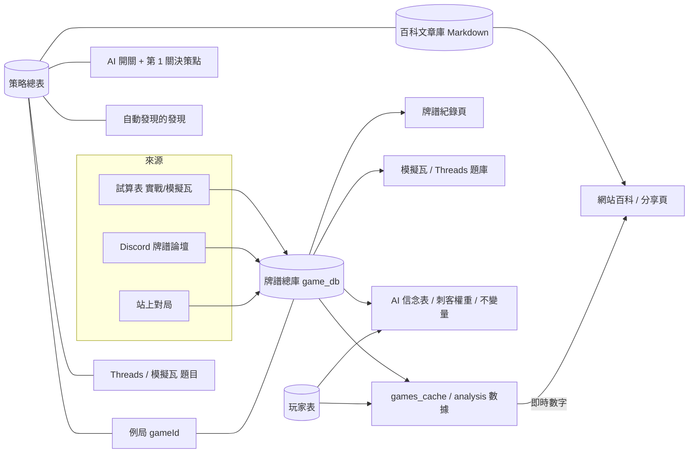

# 阿瓦隆百科系統全整合：盤點、目標架構、分階段計畫

> 起因：站長 2026-11-17「我希望你真對整個阿瓦隆百科做系統全整合 因為目前看起來 資源跟數據來源不是唯一 比如遊戲牌譜/數據/百科AI/攻略文章跟觀念 等等的 這些應該都要完全串在一起」。
> 本文件是第 0 階段：盤點現況、定目標架構、排階段。機器可讀的盤點表在 [`sources.json`](sources.json)。
> 盤點對照的程式版本：main `caf58fc`（2026-11-17）。

## 結論

- 現在沒有「唯一的來源」。同一局牌譜在 repo 裡最多有 **5 份**，由 **4 套** 解析器各自讀；AI、模擬瓦、網站數據讀的不是同一份。
- 最嚴重的是：**AI 的刺客模型、湖中判斷、不變量檢查和模擬瓦題庫，讀的是 4 月凍結的試算表快照**（`sheets_cache.json`，2,146 局），網站數據讀的是每天更新的 `games_cache.json`（2,336 局）。兩邊看到的局不一樣，AI 學不到 4 月之後的局。
- 「強者」有 **3 種定義**；百科文章裡有 **255 個寫死的百分比**（18 篇），數據更新了文章不會跟著變。
- 目標：五個正本（牌譜總庫、玩家表、百科文章庫、策略總表、站上對局紀錄），其他全部從正本產生；所有東西用固定編號互相連結。
- 第 1 階段（牌譜總庫）另一個工作正在做（分支 `claude/game-db`）。

## 1. 現況盤點

### 1.1 牌譜（同一局有好幾份）

| 檔案／來源 | 內容 | 怎麼產生 | 誰在讀 | 多久更新 |
|---|---|---|---|---|
| Google 試算表「牌譜」分頁 | 實戰牌譜正本（人工登錄） | 人工 | 每晚的 `refresh-analysis-cache.yml` | 隨時 |
| Google 試算表「模擬瓦」分頁 | 模擬局 | 人工 | `discord_records_export.py --sim-sheet` | 隨時 |
| Discord 牌譜論壇 | 貼文牌譜（部分讀不懂） | 社群貼文 | `discord_records_export.py` | 隨時 |
| `packages/server/games_cache.json` | 2,336 局（試算表 2,146＋Discord 190），解析後每局資料 | `generate_cache.py`（每晚） | 網站數據分析、`shared/src/stats/*`、PR 量尺、信念表擬合、強者分析 | 每晚 |
| `packages/server/records_cache.json` | 3,685 篇（可讀 3,009、讀不懂 676），實戰＋模擬，去重 | `discord_records_export.py`＋`records_merge.py`（每晚） | 網站牌譜紀錄頁、模擬瓦公布連結、Threads 候選 | 每晚 |
| `packages/server/sheets_cache.json` | 試算表 2026-04-03 快照（含 `牌譜`、`同贏`、`同輸` 等分頁） | 手動，**已凍結** | AI 刺客模型權重、`GoodLakeInfo`、不變量 CI、`sheetsReplay` 基準、模擬瓦題庫建置 | 不更新 |
| `packages/server/sim_bank.json` | 1,778 局題庫（無名字、無日期） | `scripts/buildSimBank.ts` 讀 `sheets_cache.json` | 模擬瓦、Threads 出題 | 手動 |
| `content/_data/*.yaml` / `*.csv` | 更早的試算表匯出（含 `data`、`data_clean`、`database_sim` 等） | 舊匯出 | `parser.yml` 只檢查能不能讀；`roleVideos.ts` 讀影片清單 | 不更新 |
| `data/sheets_export/` | 舊試算表匯出 | 舊匯出 | 沒有程式讀 | 不更新 |
| `avalon-game-records/games/` | 網站上真人對局的紀錄（每局一檔） | `GitHubGameArchive.ts` | `game-records-exports.yml` | 有人在站上打就寫 |
| `avalon-game-platform/`（8.6 MB） | 舊版整個平台的複本 | 舊 | 只有一份舊的 `routes/analysis.ts` 引用 | 不更新 |

解析器（讀同一種牌譜記號）至少有 4 套：`generate_cache.py`（Python）、`discord_records_export.py`（Python）、`ai/benchmark/sheetsReplay.ts`＋`bots/simulation/bankCodec.ts`（TS，讀快照）、`shared/src/stats/dataset.ts`（TS，讀 `games_cache`）。

### 1.2 數據

| 來源 | 內容 | 怎麼產生 | 誰在讀 |
|---|---|---|---|
| `analysis_cache.json`（6.4 MB，gzip 0.47 MB） | 總覽、玩家、默契、任務、湖、座位、隊長、陣容強度、排行、Elo… | `generate_cache.py`（Python，每晚） | 網站 API、Discord/LINE 數據指令、排行 V3 |
| `packages/shared/src/stats/*`（TS） | 同一批數據的 TS 版引擎＋複合篩選、自動發現、決定性票、兩紅分組 | 網站即時算（讀 `games_cache`） | 網站分析分頁 |
| `scripts/build_stats_parity_fixtures.py`＋`parity.ts` | 檢查 Python 與 TS 兩套算出來一模一樣 | CI | — |
| `voting_stats.py`、`analysis/avalon_analysis.py` | 更早的 Python 分析 | 手動 | 沒有網站功能讀 |
| `docs/ai/strong_metrics.md` 等 | AI 用的強者指標（文件） | 手動 | 人讀 |

### 1.3 玩家

| 來源 | 內容 | 備註 |
|---|---|---|
| `player_aliases.json` | 別名對照 | 公開 repo 允許的例外 |
| `analysis_cache.json` → `players`／`rating` | PR、Elo、場數 | 每晚 |
| `content/_data/個人資料卡.yaml` | 舊的個人資料卡 | 待確認是否該留在公開 repo（見第 8 節） |

### 1.4 百科文章與觀念

| 來源 | 內容 | 誰在讀 |
|---|---|---|
| `packages/server/wiki_data.json` | 40 篇（來源標 `hackmd`／`wiki`），網站百科的正本 | 網站（vite 打包）、心智圖、分享頁 `/w/<id>/`、`analysis` 路由 |
| `packages/web/src/data/wiki.ts` | 11 篇寫死在程式裡的文章 | 網站 |
| `packages/web/src/data/wikiRedirects.ts` | 舊編號 → 新編號（11/11 整併 57 → 40） | 網站 |
| `docs/avalon-wiki/`（32 篇 Markdown） | 較早的 Markdown 版 | 只有 `llmsTxt.ts` |
| `content/wiki_legacy/`、`content/hackmd_backup/` | 更早的備份 | 沒有程式讀 |
| `docs/wiki-proposals/2026-11_research_proposals.md` | 47 條提案，等站長勾選（#36） | 人讀 |
| 角色文章裡的「實戰數據卡」 | 即時數據 | 只有角色文章有 |

### 1.5 百科AI

| 來源 | 內容 | 讀哪一份牌譜 |
|---|---|---|
| `src/ai/AgentTuning.ts`（`DEFAULT_AGENT_TUNING`）＋各回合 `BlueRoundNN.ts` | 開關與預設 | — |
| `src/ai/belief/likelihoods*.json` | 信念表（真人概似） | `games_cache`（`fitBeliefLikelihoods.ts`） |
| `src/ai/infl/policy_strong.json`、`recursive_strong.json` | 強者政策表 | `games_cache`＋`analysis_cache`（`strongCohort.ts`） |
| `src/ai/assassin/assassinModelWeights.ts` | 刺客模型 | **`sheets_cache`（4 月快照）** |
| `src/ai/GoodLakeInfo.ts` | 湖中判斷 | **`sheets_cache`** |
| `src/ai/invariants/*`、`benchmark/sheetsReplay.ts` | 不變量、基準測試 | **`sheets_cache`** |
| `src/ai/priors/top10_behavior_priors_*.json` | 舊的行為先驗 | 舊匯出 |
| `docs/ai/wiki_sop_map.md` | 180 條百科原則 ↔ 程式對照 | 人工維護 |
| `docs/ai/optimization_loop.md` | 每回合紀錄 | 人工維護 |

### 1.6 社群內容

| 來源 | 讀哪一份 |
|---|---|
| 模擬瓦（Discord/LINE） | `sim_bank.json`（→ `sheets_cache`）＋`records_cache`（連結） |
| Threads 每日一題（#44、#47，分支 `claude/threads-*`） | `sim_bank.json`＋`games_cache`（S）＋`records_cache` |
| Discord/LINE 數據指令 | `analysis_cache.json` |

### 1.7 研究

| 來源 | 內容 |
|---|---|
| `docs/ai/research/library/`（papers、wiki） | 論文與百科對照庫（#25） |
| `docs/ai/research/r7_*`、`research/avalon_inference_v0_2` | 推論研究 |

## 2. 十大重複與不一致

| # | 問題 | 影響 |
|---|---|---|
| 1 | **AI 與模擬瓦讀 4 月凍結快照**（`sheets_cache.json`），網站讀每晚更新的 `games_cache.json` | AI 刺客模型、湖中、不變量、題庫都沒有 4 月後的局；兩邊數字對不起來 |
| 2 | 同一局最多 5 份（試算表、`games_cache`、`records_cache`、`sheets_cache`、`content/_data`），各自去重或不去重 | 局數各說各話：2,146（快照）／2,336（`games_cache`）／2,950（牌譜頁的實戰，含 Discord，11/16 整併時）／3,009（牌譜頁可讀的實戰＋模擬，現在） |
| 3 | 4 套牌譜解析器 | 同一行記號在不同地方可能解析成不同結果；修一個漏三個 |
| 4 | 數據引擎 Python（`generate_cache.py`）與 TS（`shared/src/stats`）各一套，靠 parity 檢查維持一致 | 每加一個指標要寫兩次 |
| 5 | 「強者」三種定義：網站分組用 PR 切點（`cohort.ts`）、AI 強者池用 Elo 前 20%＋50 場（`strongCohort.ts`）、高強度局 AI 用平均 Elo 前 30% vs 網站用 S ≥ 65（`strength.ts`） | 「跟強者比」的結論依定義不同而不同 |
| 6 | 百科 255 個寫死的百分比（18 篇；最多的兩篇各 74～75 個） | 數據更新後文章過時 |
| 7 | 百科文章 4 份：`wiki_data.json`（40）、`wiki.ts`（11 篇寫死）、`docs/avalon-wiki`（32）、`content/wiki_legacy`＋`hackmd_backup` | 改一處其他不會跟著改；舊任務 #6 一直沒做 |
| 8 | 紅方角色、座位寫法在多處各自定義（`RED_ROLES` 至少 4 處、`seatLabel` 至少 3 處） | 「0 家」這類規則要逐處改 |
| 9 | 策略 ↔ 程式 ↔ 數據沒有共用編號：`wiki_sop_map.md` 用 B27 這類編號、開關用程式名、自動發現沒有編號、百科文章用 `wiki-NNN` | 無法從一篇文章找到對應的 AI 行為、支撐數據、例局 |
| 10 | 舊資料夾仍在 repo：`avalon-game-platform/`（整個舊平台）、`data/sheets_export/`、`analysis/`、`content/_data` 的舊匯出 | 搜尋與維護時混淆，新人／其他 AI 會讀錯 |

## 3. 目標架構

### 3.1 五個正本

| 正本 | 內容 | 主鍵 | 狀態 |
|---|---|---|---|
| 牌譜總庫 `game_db` | 每一局實戰／模擬一筆：完整牌譜、所有來源、重複歸併、逐條檢查結果 | 固定局號 `gameId` | 第 1 階段進行中（`claude/game-db`） |
| 玩家表 `players` | 別名、PR、Elo、場數、分組（強者等**一種**定義） | 玩家內部編號（公開輸出只放組別） | 第 2 階段 |
| 百科文章庫 `wiki/` | 一篇一個 Markdown（含前置資料：編號、標題、分類、標籤、相關策略編號、例局局號），數字用即時引用 | `wiki-NNN`（沿用現有編號） | 第 3 階段（解決舊任務 #6） |
| 策略總表 `strategies` | 每條策略一筆：說明、出處文章、對應 AI 開關、第 1 關決策點、自動發現的編號、支撐數據、例局 | 策略編號（沿用 `wiki_sop_map` 的 A1～K8） | 第 4 階段 |
| 站上對局紀錄 | 網站上真人／機器人對局（`avalon-game-records/`） | 對局編號 | 已有；第 2 階段接進牌譜總庫（分開標示） |

其他全部是**產生出來的**：`games_cache`、`records_cache`、`sim_bank`、`analysis_cache`、AI 信念表／刺客權重、Threads 候選、網站分享頁。

### 3.2 連結方式

具體的連結欄位：

| 從 | 到 | 怎麼連 |
|---|---|---|
| 百科文章 | 引用的數字 | 文章裡寫 `{{stat:指標編號?篩選}}`，建置時從數據算，不再寫死 |
| 百科文章 | 例局 | 前置資料 `examples: [gameId…]`，頁面顯示牌譜連結 |
| 百科文章 | 策略 | 前置資料 `strategies: [B27…]` |
| 策略 | AI | `knobs: [loyalFresh43…]`、`gate1: [決策點定義]`、`rounds: [43…]` |
| 策略 | 自動發現 | `findings: [發現編號]`（自動發現加穩定編號 = 單位＋維度＋指標＋組別的雜湊） |
| 策略 | 支撐數據 | `stats: [指標編號]` |
| Threads／模擬瓦題目 | 局、策略、文章 | 題號帶 `gameId`；第一則留言從題目的策略找文章 |
| AI 回合紀錄 | 策略 | `optimization_loop.md` 每回合寫策略編號 |

## 4. 分階段計畫

| 階段 | 內容 | 驗收 | 誰做 |
|---|---|---|---|
| 0 | 本文件與 `sources.json` | 站長看過；ChatGPT 審查合併 | Claude（寫）、ChatGPT（審） |
| 1 | 牌譜總庫：盤點各來源、逐條檢查規則、去重、錯誤清單、每晚更新 | 每一局只有一筆；每筆列出所有來源；錯誤清單按規則統計；舊輸出不變 | Claude（分支 `claude/game-db`）；互相矛盾、只有站長能判斷的局 → 站長 |
| 2 | 各處改讀牌譜總庫：`games_cache`、`records_cache`、`sim_bank`、AI（刺客權重、湖中、不變量、基準）、Threads 都從總庫產生；**淘汰 `sheets_cache.json` 快照**；玩家表統一一種「強者」定義；牌譜解析器只留一套 | 換來源前後逐局比對（差異都能用「多了 4 月後的局」或「錯誤已修正」解釋）；AI 預設對局逐局相同或差異有說明；CI 綠 | Claude；強者定義由站長選 |
| 3 | 百科文章庫：40＋11 篇轉成一篇一個 Markdown，`wiki_data.json` 改由建置產生；寫死的數字換成即時引用；`docs/avalon-wiki`、`content/wiki_legacy`、`hackmd_backup` 標成封存 | 網站顯示前後一致（逐篇比對）；255 個寫死百分比逐一換掉或標「歷史數字」 | Claude（轉檔與建置）、ChatGPT（逐篇校對內容、換數字引用）、站長（47 條提案勾選 #36） |
| 4 | 策略總表：`wiki_sop_map.md` 180 條轉成機器可讀；接上 AI 開關、第 1 關決策點、自動發現編號、例局 | 每條策略至少有出處文章；AI 開關都有對應策略；自動發現的「可能的策略」能指到策略編號或標「新策略候選」 | Claude（結構與連結）、ChatGPT（文字與出處核對） |
| 5 | 全部用策略總表當鑰匙：AI 每回合候選從總表與自動發現挑；Threads／模擬瓦題目帶策略與文章；百科文章顯示「AI 怎麼做、數據怎麼說、例局」 | 從任一篇文章能點到：數據、例局、AI 行為；從任一題能點到文章 | Claude、ChatGPT |
| 清理 | `avalon-game-platform/`、`data/sheets_export/`、`analysis/`、`content/_data` 舊匯出：先標封存，確認沒有讀取者後再刪 | 刪檔前列清單 | 刪檔要站長親口同意 |

## 5. 要站長決定的

1. 「強者」統一用哪一種定義（PR 切點／Elo 前 20%／S ≥ 65 對應的局）。
2. 牌譜總庫找出的互相矛盾、只有站長能判斷的局（第 1 階段會列）。
3. 舊資料夾刪除（清理階段會先列清單）。
4. 47 條百科提案勾選（#36，已在等）。

## 6. 跟其他工作的關係

| 工作 | 關係 |
|---|---|
| 牌譜總庫（`claude/game-db`） | 第 1 階段 |
| Threads #44、#47、自動發佈（`claude/threads-*`） | 第 2 階段改讀總庫；第 5 階段題目帶策略編號 |
| #46 投票組量尺分析、第 43 回合 | 第 4 階段起，回合紀錄寫策略編號 |
| 自動發現 → 策略候選（`claude/discovery-candidates`） | 第 4 階段的自動發現編號 |
| #35、#21 數據分頁整理（ChatGPT） | 第 2 階段之後做，避免整理到一半資料來源又換 |
| #36 百科提案 | 第 3 階段寫進 Markdown 文章庫 |

## 7. 不在本文件範圍、順手記下的

- `content/_data/個人資料卡.yaml` 等舊匯出在公開 repo 裡，是否含玩家個資要確認；若有，清理階段優先處理（刪檔與改寫歷史要站長同意）。
