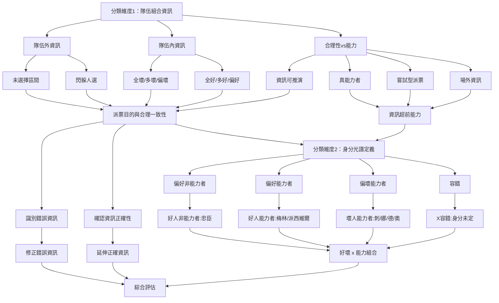

# 解讀前人派票 - 延伸、修正、尊重、分類與有意識的派票

> 本文分五部分：一、延伸、修正與尊重（怎麼回應前人的派票）；二、第二層思考（從前人的派票往下推演）；三、分類與反饋（先分類資訊與身分，再決定回應）；四、有意識的派票（派票之前與之後要想什麼）；五、照派與跟派（牌局範例）。

## 一、延伸、修正與尊重

### 延伸

- A 派 ABC；
- B（梅林）派 BCD：延伸 A 的派票。
- 【建議】延伸＝認同 A 的「隊伍資訊」，不一定認同 A 的「隊長身分」：B 延伸 A 的派票資訊，不代表 B 認同 A 的陣營身分。
- 【經驗】實戰上，延伸的人多半也偏向認 A 是好人，但這是延伸常見的伴隨解讀，不是延伸本身的意思。

### 修正

- A 派 ABC；
- B（梅林）派 BDE：修正 A 的派票（本站稱為「修正他人」；調整自己先前派票的區間則是「自我修正」，見[能力者與超前資訊 - 誰有內建資訊、怎麼分辨好壞能力者](wiki:wiki-50)〈自我修正與前後矛盾的差別〉）。
- 【經驗】修正「通常」代表認為 A、C 至少有一壞：
  - A 派的 C 不好；
  - 或是 A 本人不好。

### 注意事項

- 【經驗】修正與延伸，有時需要依據場上全部的派票調整。
- 例如 149、268、369 之後：
  - 4 家是梅林，拇指在 679；
  - 代表前面三家都派錯了，這時候不論修正誰或延伸誰都相對奇怪；
  - 因此可能出現「非延伸也非修正」的派票，例如 480、458、450。
- 這種狀況通常應該：
  - 從前方派票者中排序好壞：Good（G）> Normal（N）> Bad（B）；
  - 透過雜魚視角把 G 帶進你的派票；
  - 透過派票表達 B 很壞，以及 B 的組合很壞。

### 3 家對「1AB、2CD」之後的解讀與反饋

- 把延伸與修正放進 1AB、2CD 的情境，再多一種「尊重」。
- 如果你是 3 家忠臣，面對 1AB、2CD 這種類型的派票該怎麼辦？
- 最常見的例子（1、2 的選擇完全不重複）：

```text
147, 260
148, 269
149, 267
169, 258
158, 249
```

#### 框架核心：反對／尊重／認同

- **反對＝修正**
  - 不信任某位玩家的派票資訊；
  - 對組合做出對立的派票；
  - 修正原組合的資訊。
- **尊重＝參考**
  - 資訊有參考價值；
  - 不刻意加強；
  - 不刻意對立。
- **認同＝贊成＝延伸**
  - 認同該派票的隊伍資訊（不一定認同隊長的身分）；
  - 加強組合人選，並以此延伸後續邏輯；
  - 盡力避開該派票中沒選的人，以及可能的多壞區間。

#### 實際案例：147、260

> 以下為【經驗】思考流程。

##### 3 家忠臣的思考

- 先判斷是否認定 2 的身分（偏好／偏壞）。
- 解讀 2 釋放的資訊，再決定對 2 的資訊如何反饋（反對／尊重／認同）。
- **認為 2 偏好 ⇒ 可以選 2**
  - 2 是梅林 ⇒ 認同
  - 2 是派西 ⇒ 認同或尊重
  - 2 是忠臣 ⇒ 尊重或反對
  - 補充：
    - 如果認為 2 是忠臣又認同 2 的資訊，會顯得很像能力者；
    - 並非不能認同，而是[廣泛性／遊戲分支](wiki:wiki-62)、合理性、容錯率的取捨；
    - 身為 3 家忠臣，理論上沒有足夠資訊在 1-2 之後就直接認同 2 家的資訊；
    - 如果大前提是認為 2 家是忠臣，就更沒有依據直接認同 2 家的資訊正確。
- **認為 2 偏壞 ⇒ 不選 2**
  - 2 是一壞派兩好 ⇒ 尊重或認同
    - 補充：這時通常選擇尊重而非認同，因為資訊傳遞可能造成誤會：
      - 認同 60 偏好、又認 2 偏壞，加上 147 至少一壞、可能多壞 ⇒ 1247 多壞；
      - 因此偏好區間變成 3 + 60，589 有最後一壞；
      - 看到 147、260、360 的人，不會知道 3 家怎麼定義 2 家，可能把 2 當容錯（X）；
      - 但對容錯（X）派出的組合怎麼會直接認同？這會有[邏輯一致性](wiki:wiki-26)的問題；
      - 另一種選擇是外灑認同 60 兩好，但做出和 2 所釋放資訊對立的資訊，例如 147、260 之後派 560 3+（外灑強調認同 60，但派 5 表達沒有要洗尾家）。
  - 2 是一壞派隊友 ⇒ 反對
- 對 2 家資訊的解讀：
  - 60 偏好；
  - 147 至少一壞，可能兩壞；
  - 589 至少一壞，可能兩壞；
  - 5 偏壞，89 可能有最後一壞。

##### 最終決策

- **認同**
  - 260 至少選二；
  - 透過外灑對 5 表達敵意；
  - 嘗試區分 147／89 中的好人（做出能力者視角的假設）。
  - 範例：230、690 3+、268 3+
- **反對**
  - 選 2，但不碰 60（至少一壞）；
  - 做出和 60 對立的資訊（嘗試外灑並派 5）；
  - 從 147／589 中選擇。
  - 範例：238、457 3+、379
- **尊重**
  - 147 不能同時選兩人（2 反對的區間）；
  - 589 不能同時選兩人（2 沒選的區間）；
  - 盡可能不要選 5 家。
  - 範例：3 + 6/0 + 1/4/7；3 + 6/0 + 8/9

## 二、第二層思考

> 這一部分談的是：從前一家的派票出發，往下推演（拓展）不同視角下的可能。以下皆為 10 人局的【經驗】推演。

### 範例：1 家派 168，2 家怎麼想

- 2 家的思考方向有幾種：
  - 先當自己是忠臣來思考；
  - 若 1 是派西或梅林、在閃拇指 ⇒ 79／34 有壞；
  - 若 1 是壞人、疊隊友 ⇒ 68 有壞；
  - 若 1 是壞人、閃隊友 ⇒ 79／34 有壞；
  - 1 不派 5 的可能原因：5 有尾派，想給 5 更多資訊；
  - 1 不派 0 的可能原因：0 有湖中，而且是 2-5，先不派。

#### 認 1 是梅林

- 79 幾乎不能派，34 應該會有最後一隻。
- 如果認 50 兩好：
  - 第二層思考：要不要展開「50 兩好」的視角？
  - 如果要展開分支，可以選擇外灑：1/6/8 + 5/0 + 3/4 各選一個；
  - 或是 50 + 6/8 選一個。
- 如果認 50 有壞：
  - 50 應該最多一壞 ⇒ 否則 1 會外灑；
  - 第二層思考：外灑但不派 50，79 有壞；
  - 所以是 1 + 6/8 + 3/4 各選一個。
- 局勢從這裡產生可能的未來分支，詳見[大局觀 - 平衡、廣泛性、平滑與極化](wiki:wiki-62)。
- 能夠正確分出 3／4、沒選到拇指，你就會成為梅林人選。

#### 認 1 是派西

- 79 可能有他的拇指，另一根拇指可能在 34：
  - 派西如果拇指在 50，不太會派 168，但沒有一定；
  - 68 沒有他的拇指，但可能還是有壞；
  - 這時要選擇要不要派 79 ⇒ 繼續往下拓展。

#### 認 1 是壞人

- 可能一：1 是單純根據視角派票的壞人：
  - 不論疊隊友或閃隊友，6789 幾乎都不能派；
  - 所以可以乾脆外灑：5 + 340 選二。
- 可能二：1 是會控制或創造視角的壞人：
  - 隊友在 34 + 5/0，6789 都沒有隊友；
  - 故意派 168 創造錯誤的（假的）視角。
- 可能三：1 是奧伯倫，所以沒有任何視角。

### 重點小結

- 重點不在於派了什麼組合，而在於每一種派票都是從不同視角推演出來的。
- 其他人會進一步思考這些派票：
  - 2 家的派票有沒有參考 168，並展示出定義；
  - 能不能從 168 加上 2 家的派票做進一步拓展；
  - 場上如何解讀 1 家、2 家的派票（陣營、好壞、偏能力或偏雜魚）。
- 特別注意：
  - 不論派 345／450／340，或是 560／580／145，都有合理解釋；
  - 【經驗】但一般不會選擇像 279 這種和 1 完全反向的派票；
  - 通常這樣選完，如果 1、2 真的是兩好，會導致 1、2 雙雙被排除在任務外。

## 三、分類與反饋

- 【經驗】先對玩家的資訊與身分做分類，再做綜合評估。

### 分類維度一：派票資訊

#### 合理性 vs 能力

- 根據當下的資訊，能不能推出該玩家選的組合？
- 資訊超前的幾種可能：本身是能力者／嘗試型派票／場外資訊。

#### 隊伍組合

- 隊伍內資訊：組成。
- 隊伍外資訊：沒被選的區間、被閃躲的人選、被看到的人選。
- 光譜：全好／多好／偏好／偏壞／多壞／全壞（兩端代表越極端、越明確的資訊，中間代表模糊的資訊）。
- 並考慮[**邏輯一致性**](wiki:wiki-26)。

### 分類維度二：身分光譜

- 好壞程度：好人／偏好／X 容錯／偏壞／壞人。
- 能力強弱：能力者／非能力者。
- 好壞程度 × 能力強弱：
  - 好人能力者（梅林、派西）
  - 好人非能力者＝忠臣
  - 偏好／X 容錯／偏壞（無法定義身分）
  - 壞人能力者＝刺客、莫甘娜、莫德雷德、奧伯倫

### 假設 1 家派常見的開局 147／148

- 【經驗】147／148 是常見的 1-1 開局：派自己、人選分散、不碰 5／0（為什麼常見見 [開局與派票位置 - 從 1-1 到 2-5](wiki:wiki-205)）。組合本身沒有對錯，錯的是不經思考地固定派（見[常見錯誤 - 派票、黑白球、湖中、觀念與品格](wiki:wiki-90)〈遊戲觀念〉）。
- 1 家的派票合理性：
  - 1-1 沒有可評估的合理性。
- 1 家的隊伍內資訊：定義 4、8。
  - 48 全好／偏好（最多一壞）／偏壞（至少一壞）／全壞。
- 1 家的隊伍外資訊：定義區間。
  - 23／(5)67／90 區間。
- 1 家的邏輯一致性：
  - 若認為 1 派的 48 偏好 ＝ 1 在閃壞人 ＝ 隊伍外區間偏壞；
  - 若認為 1 派的 48 偏壞 ＝ 1 在疊壞人 ＝ 隊伍外區間偏好；
  - 補充：有沒有可能「1 派的 48 偏壞，同時隊伍外區間也偏壞」？
    - 會有這種情形，但偏少，先思考可能性較高的情況即可；
    - 要做到這種效果，有時會導致派票變形或沒有合理性（＝開能力）。
- 1 家的身分光譜：
  - 好壞程度：這類常見開局通常被視為「容錯」或「偏壞」；
  - 能力強弱：這類常見開局沒有能力；
  - 身分總結：要透過後續派票的反饋重新定義。

### 做好分類後，再決定從哪個定義出發

#### 思考流程圖



- 先整理派票資訊＋身分：
  - 這些資訊是否正確？不正確的話，錯在哪裡？
  - 延伸正確的資訊、修正錯誤的內容，給出派票。

#### 範例 1：1 家派 148，2 家是忠臣（10 人局）

**情境一**

- 隊伍內資訊：48 偏好（最多一壞）。
- 隊伍外資訊：3 是 1 給出的區間壞人，567／90 是剩下的區間。
- 1 的身分總結：容錯偏壞。
- 視角調整與定義：
  - 1 是容錯偏壞，因此不選；
  - 48 偏好 ⇒ 至少選一位；
  - 567／90 是剩下的區間 ⇒ 嘗試在 567／90 中選擇；
  - 但為了釋放資訊，先排除 5／0 不派。
- 最終組合：2 + 4/8 + 6/7/9 選一 ⇒ 289。
- 延伸 1 的資訊（認同「48 偏好」這個隊伍資訊，即使 1 本人是容錯偏壞），並嘗試選出 9 是好人。

**情境二**

- 隊伍內資訊：48 偏壞（至少一壞）。
- 隊伍外資訊：23／567／90 是剩下的偏好區間。
- 1 的身分總結：容錯偏壞。
- 視角調整與定義：
  - 1 是容錯偏壞，因此不選；
  - 48 偏壞 ⇒ 不能選；
  - 3／567／90 是錯誤區間 ⇒ 嘗試做出不同的區間，例如 50；
  - 為了傳遞「148 多壞」的視角並給出資訊，進行外灑。
- 最終組合：3 + 679 選二 ⇒ 369 2+。
- 修正 1 的資訊，並嘗試定義 50 這個區間。

#### 範例 2：1 家派 168，2 家是忠臣（10 人局）

**情境一**

- 隊伍內資訊：68 偏好（最多一壞）。
- 隊伍外資訊：1 給出的壞人區間可能是：
  - 79／34／50；
  - 3479 多壞；
  - 790 多壞。
- 1 的身分總結：偏好。
- 視角調整與定義：
  - 1 偏好，因此可以列入選擇；
  - 68 偏好 ⇒ 至少選一位；
  - 不論剩餘區間是哪一種：
    - 幾乎不會去嘗試 79；
    - 34 可以是多壞，而且 3 接下來有派票權，不優先考慮；
    - 因此幾乎會選剩下的 50。
- 最終組合可以是：
  - 2 + 6/8 + 1/5，少量可能嘗試 4/0；
  - 合理組合舉例：
    - 不外灑：256、128、248、260……
    - 外灑：160、458……

**情境二**

- 隊伍內資訊：68 偏壞（至少一壞）。
- 隊伍外資訊：79／34／50 是錯誤區間。
- 1 的身分總結：容錯偏壞。
- 視角調整與定義：
  - 1 是容錯偏壞，因此不選；
  - 68 偏壞 ⇒ 不能選；
  - 79／34／50 是錯誤區間 ⇒ 嘗試做出不同的區間：
    - 50 可能有 1 的隊友，因此 3479 多好；
    - 34 可能有 1 的隊友，因此 5790 多好；
  - 為了傳遞「168 多壞」的視角並給出資訊：
    - 79 至少選一；
    - 如果要定義 50 的好壞，可以嘗試外灑 50。
  - 因此最終組合為：2 + 7/9 + 5/0，並考慮選 3/4。
- 考慮 50 可能有 1 的隊友：
  - 沒辦法馬上定義 5／0：組合可以是 247、249；
  - 願意嘗試定義 5／0 並外灑：組合可以是 470、459……
- 考慮 34 可能有 1 的隊友：
  - 沒辦法馬上定義 3／4：組合可以是 257、259。
- 修正 1 的資訊，並嘗試定義 50 這個區間。

### 區間要追到源頭

- 【經驗】一個區間是從誰的派票推出來的，就要回頭問：它成立需要那個人是什麼身分？

#### 沒被派到，不等於被表壞

```text
169
236
367
478
259
ooo
```

- 4、5 在 236、367 都沒被派 => 很容易讀成「45 一壞」
- 【經驗】但 2 延伸 1 的 6、3 再延伸 2 的 36，123 只是**順著走**
  - 順著前一家延伸的派票，沒派到的人只是「沒輪到」
  - 123 並沒有在給「45 有壞」的資訊
- 【經驗】除非你確定 23 裡有壞（壞人在閃隊友或刻意不碰某人），否則「45 一壞」不能當成定論

#### 用奧伯倫的派票推出來的區間

- 【邏輯】奧伯倫不知道隊友，他的「閃」沒有資訊
- 例：1 家奧伯倫派 157，有人據此讀出「16 至少一壞」 => 前提不存在
- 這種推不出來的區間，詳見[視角與區間派票法](wiki:wiki-57)「無奈區間」

## 四、有意識的派票

### 派票之前

#### 思考場上的資訊流

- 前面的人派了什麼：
  - 解讀場上的資訊流（客觀／旁觀視角）；
  - 是否有獨立資訊、雙重假設、邏輯一致性；
  - 是否有換位思考、跟隨場上共識、平衡局勢。
- 代入自己的身分與資訊：
  - 加入自己的身分與資訊後，再解讀場上的資訊流（主觀視角）；
  - 選出自己的組合，回頭檢查是否合理、是否突兀、是否難以解讀或容易造成誤解。

#### 帶有意識

- 【經驗】不存在純隨機的派票：
  - 每次派票都是有意識、有意義的；1-1 的忠臣沒有資訊可依據，人選可以近乎隨機，但派完之後仍要用區間和黑白球賦予意義（見 [開局與派票位置 - 從 1-1 到 2-5](wiki:wiki-205)〈1 家（首位隊長）的開局策略〉、[開局與派票位置 - 從 1-1 到 2-5](wiki:wiki-205)）；
  - 【邏輯】後面的派票會延續前面的派票展開（指邏輯上的展開）；
  - 以解題比喻：紅方負責布局出題，藍方負責解題破局。
- 什麼叫做帶有意識——清楚了解：
  - 自己任務選擇背後的前提；
  - 自己要選哪些人；
  - 自己為什麼做這樣的選擇；
  - 自己的選擇在表達什麼；
  - 這樣選擇後，希望達到的效果與目的。

#### 有視角的人，沒有「隨便派」

- 【經驗】內建資訊一定會影響「隨便派」：
  - 有視角的人，就算是潛意識派票，也不會真的隨便
  - 有視角的人如果沒有克制自己，隨便派出來的組合，在其他人眼中就不會是「隨便派」
- 【經驗】反過來，不管拿什麼角色都有意識派票的老手：
  - 很難從他的派票抓到他的內建資訊是什麼
  - 只能從派票讀出他想表達的立場和視角

#### 雙向思考：誰拿到票，誰拿不到票

- 【經驗】讀一個人的派票，要同時想兩個方向：
  - 他為什麼派這些人
  - 他為什麼**不派**哪些人；場上又是誰一直拿不到票
- 【經驗】每個人的派票可以分成兩種：
  - 仔細動腦想過的派票
  - 只是順派、只是跟著疊、只是想試試看某個人就派
- 【經驗】派票的精華是「好人透過資訊，盡可能選出好人」：
  - 哪一種做法能給好人更多資訊，要很多場才能體會
  - 前提是不訴諸言語，只用派票和投票

### 派票之後

#### 思考場上的資訊流

- 後面的人派了什麼：
  - 在你後面的玩家，有沒有根據你的派票做出反應；
  - 資訊交叉比對下，場上是否認同你的資訊。
- 代入自己的身分與資訊：
  - 後面的人是否誤解你的身分或陣營；
  - 後面的人是否「利用」你的資訊做誤導。

#### 即時修正

- 每個動作之後都要思考：
  - 你的效果與目的是否達到；
  - 資訊是否正確傳遞、任務引導是否成功、場上是否認同你是好人；
  - 如果局勢不如預期，即時修正，想辦法走向你期望的結果。
- 隨機應變：
  - 派票到投黑白球並非連續動作；
  - 隨時因應場上的派票與黑白球應變；
  - 也可以「隨機變硬」（原文雙關語，意指視情況轉為強硬）。

## 五、照派與跟派（牌局範例）

> 牌局代碼：牌局片段（多場派票範例）

> 名詞：「照派／跟派」＝隊伍的選擇和某位玩家一模一樣（見[任務牌指派](wiki:wiki-150)）。本文例子以 10 人局為準，解讀皆為【經驗】。

### 照派範例 1

```text
269 1+
348 2+
137
456
456 oox
```

- 觀察：前置位有兩個人在洗 5（組合、區間不同）；4 大膽嘗試站反邊（保 5）；5 照派後任務失敗。
- 4 家忠臣視角：已知 5、6 至少一壞。
  - 假設 5／6 是一壞：
    - 5／6 是拇指：知道 4 不是梅林，要讓 4 待在失敗的任務中，壓低 4 的身分；
    - 5／6 是莫德雷德：覺得 4 有可能是梅林，要讓 4 待在失敗的任務中，降低派西對 4 的信任；
    - 5／6 是莫德雷德時的額外資訊：6／5 是沒有拇指的好人。
  - 假設 5、6 是兩壞：
    - 表示 2 的資訊可能是對的。
- 思考：如果 5 是好人，為什麼 5 要照派？
  - 推測一：前置位都很不友善、不認為 5 是好人 ⇒ 但 3 沒有明顯敵意；
  - 推測二：5 覺得 456 全好 ⇒ 有絕對的內建資訊，5 可能是梅林或派西。
- 思考：如果 5 是忠臣，為什麼 5 不應該照派？
  - 假設 6 是拇指：忠臣有 4 個（10 人局），等於直接少了兩個人能幫梅林擋刀；
  - 忠臣派得一模一樣，會讓外置位被派到的次數降低，梅林能派的人選也變少。
- 小結：
  - 照派的幾乎都是能力者；
  - 一般而言，忠臣照派的效益偏低、對場上好人幫助少，不推薦忠臣照派。

### 照派範例 2

```text
137 9+
245
378 1+
346
259 oox
3467
1379
2378 1+
1379
```

- 觀察：1379 這個組合，7、9 各派了一次，可以判斷 7、9 有能力。
- 1、3 忠臣應該思考：1379 真的是全沒拇指的組合嗎？
  - 是 ⇒ 後置位的梅林在鞏固這個組合，且能力上 9 > 7；
  - 否 ⇒ 後置位的能力者是拇指，例如 7 是拇指，則 7 已知 1、3 都不是梅林。
- 小結：
  - 派票相同，對外置位而言呈現的視角就相同；
  - 這種類型的照派很常有拇指；
  - 對外置位好人而言，難以分辨哪個是忠臣、哪個是拇指，派到拇指的機率因此提高；
  - 或者這個組合出去了但任務失敗，外置位也難以分辨是誰出的失敗。

## 延伸閱讀

- [角色玩法 - 梅林](wiki:wiki-175)〈梅林如何讓內建資訊和雜魚視角同步〉
- [視角與區間派票法](wiki:wiki-57)
- [能力者與超前資訊 - 誰有內建資訊、怎麼分辨好壞能力者](wiki:wiki-50)〈身分光譜〉
- [牌譜記錄格式與常用術語](wiki:wiki-204)〈六、派票與發言的動作用語〉

---

## 時效資料（附日期）

- 第一部分原稿最後編輯：2023-07-05；第二部分原稿最後編輯：2023-06-18；第三部分原稿無編輯日期紀錄。
- 〈有意識的派票〉：原稿最後編輯：2023-06-17。
- 〈覆盤 - 照派與跟派的牌局範例〉：原稿無編輯日期紀錄（原有兩段重複的 front matter）。

## 系列：任務派票（第 3／8 篇）

1. [任務指派（派票） - 名詞與基本邏輯](wiki:wiki-150)
2. [視角與區間派票法](wiki:wiki-57)
3. **解讀前人派票 - 延伸、修正、尊重、分類與有意識的派票**（本篇）
4. [外灑 - 動機、人選與出任務後的區間解讀](wiki:wiki-18)
5. [開局與派票位置 - 從 1-1 到 2-5](wiki:wiki-205)
6. [第一局開藍後 - 三加一還是拆車（混合策略）](wiki:wiki-2)
7. [尾家 - 強制局的派法與控尾、洗尾、保尾](wiki:wiki-206)
8. [聽牌與決勝局](wiki:wiki-207)

> 本文整合自〈3 家對 1AB, 2CD 之後的解讀與反饋〉、〈解讀前人派票（二） - 第二層思考〉、〈解讀前人派票（三） - 分類與反饋〉、〈有意識的派票〉、〈覆盤 - 照派與跟派的牌局範例〉。
